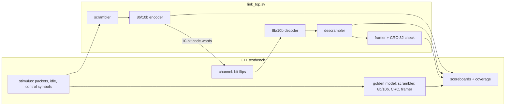
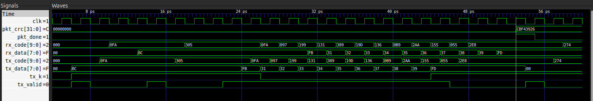

# link8b10b — PCIe Gen1/2-style link blocks with a self-checking testbench


This project has two parts. The first is a set of SystemVerilog building blocks of a serial link's physical layer:
- an **8b/10b encoder and decoder** with running disparity and error detection
- the **PCIe Gen1/2 data scrambler**
- a **CRC-32** packet checker

The second is a **Verilator testbench written in C++** that verifies them against an independent golden model:
- scoreboards that compare every output against the model
- an exhaustive decoder test
- random traffic
- bit-flip error injection
- functional coverage
- mutation testing that proves the testbench catches planted bugs

```
$ make test
lint: clean
...
13902 checks, 0 failed                                       <- golden model vs published values
[pass] directed: K28.5 on the wire, CRC check value, illegal K, abort
[pass] exhaustive decoder: 1024 code words x 2 disparities
[pass] random traffic: 20000 packets, end-to-end data and CRC
[pass] error injection: 20000 packets, 1-bit flips in one symbol
      corrupted packets                           9999
      first caught by: code violation at symbol    3387  ( 33.9%)
                       disparity error at symbol   2994  ( 29.9%)
                       disparity error later       3618  ( 36.2%)
                       CRC only                       0  (  0.0%)
                       NOT DETECTED                   0
coverage:
  encoder data symbols x RD   512 / 512
  encoder control symbols x RD  24 / 24
  ...
  functional coverage: 100%
1656108 cycles simulated, 0 errors
TEST PASSED
```

## Quick start

Requires Verilator 5.x, a C++20 compiler and make (`sudo apt install verilator` on Ubuntu 24.04 or later).

```bash
make test                      # RTL lint (-Wall), model tests, full RTL simulation
make sim FLIP=2                # inject 2-bit errors instead of 1-bit
make sim PACKETS=100000 SEED=7
make wave                      # VCD of the first 20k cycles -> build/wave.vcd (GTKWave)
scripts/mutation_test.sh       # plant 9 bugs, check each one is caught
```

## Architecture





*The start of the directed test, viewed in GTKWave (`make wave`):*
- *`tx_code` carries K28.5 as `0FA` (RD−), then `305` (RD+).*
- *The bytes `31`…`39` ("123456789") leave on `tx_data`, cross the link as scrambled code words (`097 199 131 …`), and return unchanged on `rx_data`.*
- *At the marker, `pkt_crc` reads `CBF43926`, the standard CRC-32 check value for that string. This packet deliberately carries no CRC bytes, so it measures the CRC instead of checking one.*

Every block processes one symbol per clock with one cycle of latency. A packet on the wire is `COM STP payload… CRC[4] END`, using the PCIe Gen1/2 control symbols: COM = K28.5, STP = K27.7, END = K29.7, SKP = K28.0.

## The concepts

### Why encode the line at all

A serial link sends bits with no separate clock. The receiver recovers the clock from the edges in the data (clock and data recovery), so it needs **frequent transitions**. AC-coupled links also need **DC balance**: an equal number of 1s and 0s over time, or the line's average voltage drifts. Raw data provides neither. A long string of zeros has no edges and is all one level.

### 8b/10b

Each byte `HGFEDCBA` is split into a 5-bit part `x = EDCBA` and a 3-bit part `y = HGF`, written as `D.x.y` for data or `K.x.y` for control symbols. The 5 bits become 6 (`abcdei`) and the 3 bits become 4 (`fghj`), so 8 bits are sent as 10.

- **Disparity.** Every legal 6- or 4-bit sub-block has 0 or ±2 more 1s than 0s. Unbalanced sub-blocks come in complementary pairs, one for each **running disparity** (RD) state. The encoder tracks whether it has sent one more 1 or one more 0 so far (RD+ / RD−), and picks the version that pulls the balance back. The result: the running count of 1s minus 0s at every symbol boundary is always ±1, and there are never more than 5 equal bits in a row. `tests/model_tests.cpp` checks both properties on a 200,000-symbol stream.
- **Alternate 7.** `D.x.A7` replaces `D.x.P7` for six values of x, where the primary code would create a run of five equal bits across the sub-block boundary.
- **Control symbols.** 12 extra code words carry no data and mark structure: K28.0–K28.7, K23.7, K27.7, K29.7 and K30.7.
- **Comma.** K28.5 contains the 7-bit pattern `0011111` (or `1100000`), which never appears in, or across, any sequence of data symbols. A receiver that doesn't know where symbols start searches the raw bits for it and aligns there. `model::find_comma` does exactly this, and is tested at every bit offset.

**RTL encoder** (`rtl/link_pkg.sv`, `rtl/enc8b10b.sv`). Only the RD− column of each table is stored. The RD+ code is the bitwise complement whenever the RD− code is unbalanced (plus the two RD-selected balanced codes, `111000` and `1100`).

**RTL decoder** (`rtl/dec8b10b.sv`) works in two steps:
1. **Decode, ignoring RD.** Map each sub-block back to its bits without looking at RD. Each legal 6b and 4b sub-block stands for exactly one value. The one overlap, in K28's 4b block, is resolved by the polarity of the 6b block in front of it. So this step always gives the *only* possible candidate symbol.
2. **Re-encode to classify.** Re-encode the candidate with the current RD and with the opposite RD:
   - matches the current RD → valid
   - matches only the opposite RD → **disparity error** (a legal word arriving with the wrong polarity)
   - matches neither → **code violation**

The decoder updates RD from the received bits either way, so after an error it resynchronises at the next unbalanced sub-block. Re-encoding reuses the encoder logic, which is much smaller than storing a full 1024-entry error table.

### Scrambling

`rtl/scrambler.sv` XORs each data byte with the output of a 16-bit LFSR, polynomial `x¹⁶ + x⁵ + x⁴ + x³ + 1`, seeded with `0xFFFF`. Eight serial LFSR steps are unrolled into one clock cycle.

- **Why.** Repetitive data, such as idle zeros, concentrates the signal's energy at a few frequencies (EMI). Scrambling spreads it out like noise.
- **Rules.** Control symbols are not scrambled, so the receiver can still recognise them. They still advance the LFSR, except SKP, which clock compensation may add or drop. COM re-seeds both ends, which is how they stay in step.
- **Descrambling.** XOR is its own inverse, so the same module descrambles on the receive side.
- **Check.** The model reproduces the published PCIe scrambling sequence: `FF 17 C0 14 B2 E7 02 82 72 6E 28 A6 …`.

### CRC-32

The CRC treats the message as a polynomial over GF(2) and keeps the remainder of dividing it by the generator (`0x04C11DB7`, the polynomial used by Ethernet and by PCIe's LCRC). The hardware form is a shift register with XOR taps, processing 8 bits per clock here.

The receiver runs the same CRC over the payload *and* the transmitted CRC. If nothing changed, the register always ends at the same constant, `0xDEBB20E3` (the residue). That way the checker never has to know where the payload ends and the CRC begins. The RTL is checked against the standard check value, `CRC("123456789") = 0xCBF43926`.

### Why both 8b/10b checks and a CRC

The error-injection results show the division of labour:

| bits flipped in one code word | caught by 8b/10b decoder | caught only by CRC | aborted (became a control symbol) | undetected |
|---:|---:|---:|---:|---:|
| 1 | **100%** (34% code violation, 30% disparity error, 36% disparity error later in the packet) | 0% | 0% | 0 |
| 2 | 63% | **36%** | 1.2% | 0 |
| 3 | 100% | 0% | 0% | 0 |

*(20,000 packets per row, half of them corrupted.)*

- **Odd number of flips.** The number of 1s in the word changes by an odd amount, so the receiver's RD bookkeeping goes wrong. Either the word is illegal right away, or the next RD-dependent sub-block shows up as a disparity error. END's 6b sub-block is unbalanced, so this always happens before the packet ends.
- **Even number of flips.** These can turn one legal code word into another legal code word with the same disparity. The decoder sees nothing wrong, but the data changed, and only the CRC can catch that.

A single flip can also turn data into control: D27.1 and K27.7 (STP) differ in one bit. The testbench handles the resulting "phantom" packets.

## How it is verified

**1. An independent golden model** (`model/model.cpp`). The C++ encoder uses the standard's full two-column tables, while the RTL uses one column plus a complement rule. The C++ decoder is a reverse lookup built by enumerating every legal symbol, while the RTL decodes and re-encodes. The model is pinned to published values first (code words such as K28.5 = `0011111010`, the CRC check value and residue, the PCIe scrambler sequence), so the testbench isn't checking against a wrong reference. 13,902 checks.

**2. Scoreboards.** The model runs the same stimulus in lockstep. Three in-order queues compare:
- every TX code word and illegal-K flag
- every RX symbol with its code-violation and disparity-error flags
- every packet result (done, abort, CRC ok, received CRC)

Comparisons follow the order of `valid` pulses, not fixed cycle counts, so pipeline latency can change without breaking the testbench.

**3. Test phases:**
- **Directed.** Literal wire values for K28.5 in both RDs, the CRC check value computed by the RTL, an illegal control-symbol request, and a packet aborted by a stray control symbol.
- **Exhaustive decoder.** All 1,024 possible 10-bit inputs, in both RD states.
- **Random traffic.** Packets of random length, all-zero payloads (where scrambling matters), idle symbols and random control symbols. Every received symbol must equal what was sent.
- **Error injection.** One code word in half of the packets gets flipped bits. Every corrupted packet must be detected, every clean packet must pass, and the model must predict the DUT's flags exactly, even on corrupted input.

**4. Functional coverage.** Every data byte (256) and every control symbol (12) must reach the encoder in both RD states, after scrambling. Each decoder outcome, each packet outcome, COM re-seed, SKP hold and the illegal-K flag must each occur at least once. Anything below 100% fails the run.

**5. Mutation testing** (`scripts/mutation_test.sh`). Each run plants one bug in a copy of the RTL and requires the simulation to fail. 9 of 9 are caught:

| planted bug | first symptom |
|---|---|
| alternate-7 rule uses x=16 instead of x=17 | RX symbol / code-violation mismatch |
| one 5b/6b table entry wrong (D13) | RX mismatch |
| RD rule for the `0011` sub-block | false disparity error |
| CRC polynomial off by one bit | wrong CRC of "123456789" |
| decoder never reports disparity errors | missing disparity error |
| decoder never updates its RD | false disparity error on the second K28.5 |
| scrambler LFSR tap missing | TX code word mismatch on the first scrambled byte |
| COM re-seeds the LFSR with the wrong value | TX code word mismatch |
| CRC not reset at STP | good packet reported as CRC bad |

The default regression simulates 1.66M clock cycles and checks every output against the model. CI runs it, plus a 2-bit error run and the mutation tests, on every push.

## Simplifications compared with real PCIe

- The serial line is modelled as 10-bit parallel words. There is no SerDes, clock recovery or analog behaviour. Comma alignment exists in the model only, not in RTL.
- A COM precedes every packet so both scramblers re-sync. Real PCIe sends COM inside periodic ordered sets (SKP, TS1/TS2), and training sequences are not scrambled.
- The CRC uses the Ethernet bit-ordering convention so it can be checked against the standard check value. PCIe's LCRC uses the same polynomial but a specific bit mapping, and also covers a sequence number.
- There is no link training (LTSSM), lane deskew, SKP insertion or removal for clock compensation, TLP/DLLP formats, or ACK/NAK replay. Those belong to the layers above this one.
- PCIe Gen3–Gen5 replace 8b/10b with 128b/130b encoding (a 2-bit header per 128-bit block) and a different scrambler, so this design corresponds to Gen1/Gen2 (and USB 3.0 SuperSpeed, which also uses 8b/10b).

## Layout

```
rtl/link_pkg.sv         code tables, RD rules, encode/decode functions, CRC step
rtl/enc8b10b.sv         encoder (registered, tracks RD, flags illegal K)
rtl/dec8b10b.sv         decoder (decode-then-re-encode error classification)
rtl/scrambler.sv        PCIe Gen1/2 LFSR scrambler / descrambler
rtl/link_top.sv         TX and RX paths, packet framer and CRC check
model/model.{hpp,cpp}   C++ golden model (independent tables, reverse-lookup decoder, comma finder)
tests/model_tests.cpp   model vs published values and properties
tb/tb_main.cpp          Verilator testbench: stimulus, channel, scoreboards, coverage
scripts/mutation_test.sh
Makefile                make test | sim | wave | lint | clean
```

## License

MIT. See [LICENSE](LICENSE).